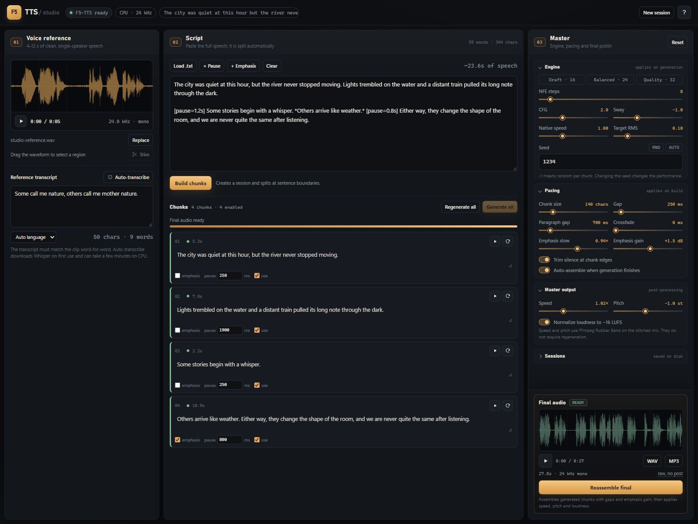
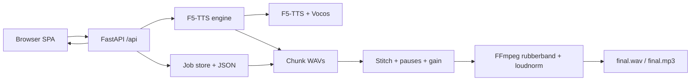

# F5-TTS Studio

A local-first web studio for [F5-TTS](https://github.com/SWivid/F5-TTS), built for long-form speech.

F5-TTS is excellent at zero-shot voice cloning. The upstream project is a research/inference release with command-line tools and Gradio demos. This fork keeps the same model and inference stack, but wraps it in a studio designed around the way narration is actually made: load a short voice reference, split a long script, regenerate individual takes, then master the final mix.

**Upstream model and training code:** [SWivid/F5-TTS](https://github.com/SWivid/F5-TTS)  
**Studio frontend and tooling:** this fork, under `studio/`  
**License:** MIT (see [LICENSE](LICENSE))




*A completed long-form session: reference waveform, four editable chunks, engine and mastering controls, and the assembled final mix.*

## Highlights

- **Long-form first.** Scripts are split at sentence and paragraph boundaries into editable chunks. Generate the whole thing, cancel safely, resume later, or redo one bad take.
- **Reference voice workflow.** Drag in audio, inspect the waveform, drag-select and trim to the strongest 4–12 seconds, type the transcript, or auto-transcribe it with Whisper.
- **Per-chunk control.** Edit text, set an individual pause, mark emphasis, mute a chunk, play a take, or regenerate it with a new seed. Chunk edits are locked while a run is active so audio cannot drift from the text.
- **Real engine controls.** NFE steps with Draft/Balanced/Quality presets, CFG strength, sway sampling, native generation speed, seed, and target RMS.
- **Mastering controls.** Time-stretch speed, pitch shift in semitones with formant preservation, loudness normalization, silence trimming, crossfades, and emphasis gain.
- **Persistent sessions.** Jobs, chunk WAVs, and finals live on disk. Reload the page or restart the server without losing work.
- **Local by design.** FastAPI serves a custom single-page app on `127.0.0.1:7862`. No frontend build step, no cloud service, no account.
- **WAV/MP3 export.** Download the mastered mix, or the raw stitched mix before post-processing.

## Quick start

### Requirements

- Windows 10/11 or Linux.
- [`uv`](https://docs.astral.sh/uv/) available on `PATH`.
- `ffmpeg` on `PATH`, with the `rubberband` and `loudnorm` filters.
- Python 3.11. The installers create the environment with `uv`.
- Optional GPU. CPU works but is slow.

### Windows

```powershell
cd path\to\F5-TTS
.\studio\install.ps1
.\studio\run.ps1
```

Or double-click `studio\run.bat`. Open <http://127.0.0.1:7862>.

Windows uses CPU unless a CUDA-capable PyTorch build is installed. ROCm is Linux-only, so a Radeon PRO W6800 is not used by PyTorch on Windows.

### Linux

```bash
cd /path/to/F5-TTS
bash studio/install.sh          # auto-detect ROCm / CUDA / CPU
bash studio/run.sh
```

Force a backend when auto-detection is not what you want:

```bash
bash studio/install.sh --rocm       # AMD ROCm 7.2, newest matching torch pair
bash studio/install.sh --rocm 6.2   # older RDNA1/2/3 GPUs
bash studio/install.sh --cpu
bash studio/install.sh --recreate   # move .venv aside and rebuild
```

If you switch between Windows and Linux, rerun the matching installer. An incompatible `.venv` is moved to `.venv.bak.<timestamp>` before the new environment is created.

### Background start/stop

`start.sh` and `stop.sh` work from bash on Linux and Git Bash/WSL on Windows:

```bash
bash studio/start.sh
bash studio/stop.sh
```

The server is detached, writes `studio/data/studio.pid`, and logs to `studio/data/studio.out.log` and `studio/data/studio.err.log`. `stop.sh` also frees port 7862 when the PID file is missing or stale.

### Configuration

| Variable | Default | Purpose |
| --- | --- | --- |
| `F5_TTS_MODEL` | `F5TTS_v1_Base` | Checkpoint/config name passed to `F5TTS` |
| `F5_TTS_DEVICE` | `auto` | `auto`, `cpu`, `cuda`, `rocm`, `mps`, `xpu`, or `npu` |
| `F5_STUDIO_DATA` | `studio/data` | Uploads, jobs, and final audio |
| `FFMPEG_BINARY` | `ffmpeg` on PATH | FFmpeg executable |
| `F5_TTS_ROCM_VERSION` | `7.2` | ROCm wheel version used by `install.sh --rocm` |
| `F5_TTS_TORCH_VERSION` | auto | Pin an exact torch version for `install.sh --rocm` |
| `F5_START_TIMEOUT` | `90` | Seconds `start.sh` waits for the port |

Detailed studio documentation lives in [`studio/README.md`](studio/README.md).

### First launch

The first model load downloads the F5-TTS v1 Base checkpoint and the Vocos vocoder from Hugging Face (about 1.5 GB). Auto-transcription additionally downloads Whisper `openai/whisper-large-v3-turbo` on first use. Both downloads are cached outside the repository.

## Workflow

1. **Voice reference** — Load 4–12 seconds of clean, single-speaker audio. Type the exact transcript, or use Auto-transcribe. F5-TTS internally clips longer references to 12 seconds; use the waveform selection and Trim to pick the best line.
2. **Script** — Paste the full speech. Blank lines become paragraph breaks. Build chunks, review the split, then Generate all.
3. **Review takes** — Play chunks, edit text or pauses, mark emphasis, mute bad sections, and regenerate only what needs another take.
4. **Assemble** — Apply speed, pitch, loudness, gaps, and crossfades. Download WAV or MP3.

### Chunk size

Chunk size is measured in **characters**, including spaces and punctuation — not words. Lower values create shorter, more granular takes; higher values give the model longer passages but make regeneration coarser.

## Controls

### Engine settings — baked into each take

| Setting | Default | Notes |
| --- | --- | --- |
| NFE steps | 32 | Diffusion steps. Draft 16, Balanced 24, Quality 32. Higher is slower. |
| CFG strength | 2.0 | Classifier-free guidance. |
| Sway sampling | −1.0 | Sway sampling coefficient. |
| Native speed | 1.00× | Affects predicted duration at generation time. |
| Seed | −1 | −1 generates a random seed per chunk. A fixed base seed is reproducible. |
| Target RMS | 0.10 | Reference loudness normalization. |
| Emphasis slowdown | 0.94× | Native speed multiplier for emphasized chunks. |

Changing these only affects new or regenerated chunks. Use **Regenerate all** to apply them to an existing session.

### Pacing — applied at build or assembly

| Setting | Default | Notes |
| --- | --- | --- |
| Chunk size | 160 chars | Maximum characters per chunk. |
| Gap | 250 ms | Default silence between chunks. |
| Paragraph gap | 700 ms | Pause applied at blank lines. |
| Crossfade | 0 ms | Overlap adjacent chunks when there is no gap. |
| Emphasis gain | +1.5 dB | Gain added to emphasized chunks at assembly. |
| Trim silence | on | Trims quiet edges of each chunk. |
| Auto-assemble | on | Assembles the final mix when generation finishes. |

### Master output — applied at assembly

| Setting | Default | Notes |
| --- | --- | --- |
| Speed | 1.00× | Time-stretch the full mix without changing pitch. |
| Pitch | 0.0 st | Pitch shift in semitones, formant preserved. |
| Normalize loudness | on | Targets −16 LUFS with FFmpeg `loudnorm`. |
| Export | WAV + MP3 | Both are generated; MP3 is 192 kbps. |

Master settings only require **Reassemble final**; they do not require regenerating chunks.

### Per-chunk options

Each chunk card has a play button, a regenerate button, an emphasis toggle, a pause field, and an enable toggle. A normal regenerate click creates a new take with a new seed; shift-click keeps the existing seed. The same seed plus the same engine settings reproduces a take.

## Script markup

| Syntax | Effect |
| --- | --- |
| `[pause=1.5s]`, `[pause=750ms]`, `[pause]` | Pause after the preceding sentence. Default is 1 s. |
| `<break time="2s"/>` | Same as a pause tag. |
| `*words*`, `**words**`, `<emph>words</emph>` | Marks the chunk as emphasized: slightly slower native delivery plus gain at assembly. |
| Blank line | Paragraph break with the paragraph gap. |

Pause tags apply after the sentence they follow. A blank line adds the paragraph gap.

## Long sessions

- Generation runs sequentially under a single inference lock, so multiple jobs queue instead of competing for memory.
- The UI polls a compact status endpoint and shows progress, ETA based on completed take times, and a safe cancel action.
- Cancellation stops after the current chunk; completed chunks are kept.
- Jobs survive page reloads and server restarts. Pending or failed chunks can be resumed with **Generate all**.
- Chunk editing and job deletion are blocked while a run is active; cancel first.
- The final mix is signature-checked against chunk versions and master settings, so the UI can show when a final is out of date.

## Project layout

```text
F5-TTS/
├── studio/
│   ├── app.py            FastAPI app, REST API, static hosting
│   ├── engine.py         model loading, chunking, jobs, stitching, FFmpeg
│   ├── static/           HTML, CSS, vanilla JavaScript UI
│   ├── install.ps1       Windows installer
│   ├── install.sh        Linux installer with ROCm/CUDA/CPU detection
│   ├── run.ps1 / run.bat Windows foreground launcher
│   ├── run.sh            Linux foreground launcher
│   ├── start.sh          detached start + PID/log files
│   ├── stop.sh           stop by PID or by port
│   └── README.md         detailed studio documentation
├── src/f5_tts/           upstream F5-TTS model and inference code
└── ...
```

Runtime data is written to `studio/data/` and is git-ignored:

```text
studio/data/
├── uploads/              converted reference WAVs
└── jobs/<id>/
    ├── job.json
    ├── reference.wav
    ├── chunk_*.wav
    ├── final_raw.wav
    ├── final.wav
    └── final.mp3
```

## Architecture



The backend avoids `torchaudio.load`, which can fail on Windows when TorchCodec cannot find a shared FFmpeg build. Reference audio is decoded with FFmpeg/pydub and loaded with SoundFile instead.

## REST API

<details>
<summary>Endpoint summary</summary>

| Method | Path | Purpose |
| --- | --- | --- |
| GET | `/api/health` | Model, device, ASR, and job status |
| GET | `/api/config` | Defaults, limits, and markup help |
| POST | `/api/references` | Upload reference audio (multipart `file`) |
| GET | `/api/references` | List references with waveform peaks |
| GET | `/api/references/{id}/audio` | Reference WAV |
| POST | `/api/references/{id}/trim` | Trim to `{start, end}` seconds |
| POST | `/api/references/{id}/transcribe` | Whisper transcription |
| POST | `/api/jobs` | Create a chunked session |
| GET | `/api/jobs` | Session list |
| GET | `/api/jobs/{id}` | Full session |
| GET | `/api/jobs/{id}/status` | Compact status for polling |
| PATCH | `/api/jobs/{id}` | Update settings, reference text, or title |
| PATCH | `/api/jobs/{id}/chunks/{cid}` | Edit chunk text, pause, emphasis, or enabled |
| POST | `/api/jobs/{id}/generate` | Generate pending, all, or specific chunks |
| POST | `/api/jobs/{id}/cancel` | Stop after the current chunk |
| POST | `/api/jobs/{id}/assemble` | Stitch and post-process |
| GET | `/api/jobs/{id}/chunks/{cid}/audio` | Chunk WAV |
| GET | `/api/jobs/{id}/final` | Final audio (`format`, `raw`, `download`) |
| DELETE | `/api/jobs/{id}` | Delete session and its audio |

</details>

The server binds only to `127.0.0.1` and has no authentication. Do not expose it to a network.

## Performance and GPU notes

- Generation is the bottleneck. Expect roughly 1–3 minutes per 10 seconds of output at 24–32 NFE on CPU. Draft mode (16 NFE) and smaller chunks make iteration much faster.
- Windows PyTorch has no ROCm backend. The studio reports CPU and uses it; a Radeon PRO W6800 is not used there. The same GPU is supported by ROCm on Linux and is substantially faster than CPU.
- On Linux, install with `--rocm` on an AMD machine. RDNA 3.5 / RDNA 4 GPUs need ROCm 7.x; older RDNA 1/2/3 cards may need ROCm 6.2.
- For GPUs not officially supported by the installed ROCm build, set `HSA_OVERRIDE_GFX_VERSION` before launching. For example: `HSA_OVERRIDE_GFX_VERSION=11.0.0 bash studio/run.sh`.
- F5-TTS is English/Chinese-centric. Other languages are limited by the base model and tokenizer.

## Troubleshooting

- **First run looks stuck** — the model is downloading. Watch the server log; cached loads take a few seconds.
- **Port 7862 is already in use** — run `bash studio/stop.sh`, or close the other studio instance.
- **Pitch or speed assembly fails** — FFmpeg is missing the `rubberband` filter. Install a full FFmpeg build.
- **Reference audio is ignored past 12 seconds** — trim it in the Voice reference panel. F5-TTS clips longer references internally.
- **Auto-transcribe is slow** — the first transcription downloads Whisper and runs on CPU unless a GPU backend is installed.
- **`torch` reports CPU on a Radeon machine** — ROCm is not available on Windows; install on Linux with `--rocm` to use the GPU.
- **Audio decode errors mentioning TorchCodec** — the backend avoids `torchaudio.load`, but FFmpeg still must be able to decode the upload. Use a standard WAV/MP3/M4A/FLAC/OGG file.

## Upstream and license

This fork builds on [SWivid/F5-TTS](https://github.com/SWivid/F5-TTS) by Yushen CHEN and contributors. The F5-TTS model, training code, and upstream inference code remain their work; the `studio/` application is the addition in this repository. Upstream documentation, training instructions, and model details are available in the upstream repository.

The repository is released under the MIT License; see [LICENSE](LICENSE). Model checkpoints downloaded from Hugging Face are subject to the terms of their respective model pages.
